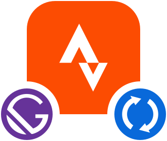

<div align="center">
  <h1>gatsby-source-strava</h1>
  <br/>
  <p>
    
  </p>
  <br/>

[![Npm][badge-npm]][npm]
[![Build Status][badge-build]][actions]
[![Coverage][badge-coverage]][codecov]
[![Downloads][badge-downloads]][npm]
[![PRs welcome][badge-prs]][contributing]
[![MIT license][badge-licence]][licence]
[![Sponsor][badge-sponsor]][sponsor]

</div>

---

Gatsby plugin to use Strava as a data source

The fetching, the rate limits and the [store](https://github.com/cedricdelpoux/strava-sync/blob/main/packages/strava-sync/docs/store.md) are done by
[strava-sync](https://github.com/cedricdelpoux/strava-sync/blob/main/packages/strava-sync), which works without Gatsby too. This plugin turns
what it stores into Gatsby nodes.

> Requires Node 22.12 or later.

## Usage

1. Download `gatsby-source-strava` from the NPM registry:

```shell
npm install gatsby-source-strava
```

2. [Generate a token](https://github.com/cedricdelpoux/strava-sync/blob/main/packages/strava-sync/docs/token.md)

The package needs 3 `.env` variables with the following format to work:

```dotenv
STRAVA_CLIENT_ID=2845
STRAVA_CLIENT_SECRET=c3d62caed3sjf4vdjsb096d010d81f52a17ac5
STRAVA_TOKEN={"access_token":"ya...J0","refresh_token":"1..mE","expires_at":1581439030,"expires_in":21600}
```

`gatsby-source-strava` expose a script to make the generation easier.

Open a terminal at the root of your project and type:

```shell
gatsby-source-strava-token
```

3. [Add the plugin](https://github.com/cedricdelpoux/strava-sync/blob/main/packages/gatsby-source-strava/docs/options.md) in your `gatsby-config.js` file

```js
require("dotenv").config()

module.exports = {
  plugins: [
    {
      resolve: "gatsby-source-strava",
      options: {
        stravaClientId: process.env.STRAVA_CLIENT_ID,
        stravaClientSecret: process.env.STRAVA_CLIENT_SECRET,
        stravaToken: process.env.STRAVA_TOKEN,
      },
    },
  ],
}
```

That's it!

> For advanced configuration, please read [options](https://github.com/cedricdelpoux/strava-sync/blob/main/packages/gatsby-source-strava/docs/options.md) documentation.

## Data

The plugin creates a `StravaAthlete` node and one `StravaActivity` node per
activity, with a `coordinates` field ready for a map. With the `withRoutes`
option, it also creates one `StravaRoute` node per route, with the same
`coordinates` field, built from their full track with the `withRouteStreams`
option. Their GraphQL types are declared by the plugin, so your
queries work even before the first activity is fetched.

## Store

Your history is fetched once and kept in a `.strava` directory next to your
`gatsby-config.js`, not in the Gatsby cache. A build only fetches the activities
you recorded since the previous one, even after a `gatsby clean` or on a fresh
continuous integration checkout.

> Strava allows 100 requests every 15 minutes and 1000 a day. Read the
> [rate limits](https://github.com/cedricdelpoux/strava-sync/blob/main/packages/strava-sync/docs/rate-limits.md) documentation before enabling options
> that fetch more of every activity.

## Commands

| Command                              | What it does                                                   |
| ------------------------------------ | -------------------------------------------------------------- |
| `gatsby-source-strava-token`         | Generates the token the plugin needs                           |
| `gatsby-source-strava-activity <id>` | Fetches one activity again, with as much detail as asked       |
| `gatsby-source-strava-activities`    | Deletes the activities gone from Strava, adds the missing ones |

They are wrappers of the `strava-sync` command line, which reads the plugin
options from your `gatsby-config.js`. The flags and the store are the same.

## Documentation

- [Options](https://github.com/cedricdelpoux/strava-sync/blob/main/packages/gatsby-source-strava/docs/options.md), everything you can configure
- [Store, in strava-sync](https://github.com/cedricdelpoux/strava-sync/blob/main/packages/strava-sync/docs/store.md), where your activities live and when they are fetched
- [Routes](https://github.com/cedricdelpoux/strava-sync/blob/main/packages/gatsby-source-strava/docs/routes.md), your Strava routes, private ones included
- [Large histories](https://github.com/cedricdelpoux/strava-sync/blob/main/packages/gatsby-source-strava/docs/large-histories.md), keeping the page queries fast with thousands of activities
- [Rate limits, in strava-sync](https://github.com/cedricdelpoux/strava-sync/blob/main/packages/strava-sync/docs/rate-limits.md), what Strava allows and how to handle it
- [Token, in strava-sync](https://github.com/cedricdelpoux/strava-sync/blob/main/packages/strava-sync/docs/token.md), generating and refreshing it
- [Fetching an activity again, in strava-sync](https://github.com/cedricdelpoux/strava-sync/blob/main/packages/strava-sync/docs/fetch-activity.md), to add details or pick up an edit
- [Syncing the activities, in strava-sync](https://github.com/cedricdelpoux/strava-sync/blob/main/packages/strava-sync/docs/sync-activities.md), to drop deleted activities and add uploaded again ones
- [Creating pages](https://github.com/cedricdelpoux/strava-sync/blob/main/packages/gatsby-source-strava/docs/create-pages.md), one page per activity

## Support this project

<p align="center">
  <a href="https://github.com/cedricdelpoux"></a>
</p>

<p align="center">
  Hi, I'm <a href="https://cedricdelpoux.fr/en">Cédric</a>.<br>
  Between my three kids, I maintain <a href="https://github.com/cedricdelpoux?tab=repositories">open source projects</a> during my free time.<br>
  If my work is useful to you, a star, a one-time tip or a monthly sponsorship all help a lot.<br>
  Thank you very much!
</p>

<p align="center">
  <a href="https://thanks.dev/u/gh/cedricdelpoux"></a>
  <a href="https://github.com/sponsors/cedricdelpoux"></a>
  <a href="https://ko-fi.com/cedricdelpoux"></a>
  <a href="https://paypal.me/cedricdelpoux"></a>
</p>

[badge-npm]: https://img.shields.io/npm/v/gatsby-source-strava.svg?style=flat-square
[badge-downloads]: https://img.shields.io/npm/dt/gatsby-source-strava.svg?style=flat-square
[badge-build]: https://img.shields.io/github/actions/workflow/status/cedricdelpoux/strava-sync/ci.yml?branch=main&style=flat-square
[badge-coverage]: https://img.shields.io/codecov/c/github/cedricdelpoux/strava-sync/main.svg?flag=gatsby-source-strava&style=flat-square
[badge-prs]: https://img.shields.io/badge/PRs-welcome-brightgreen.svg?style=flat-square
[badge-licence]: https://img.shields.io/badge/license-MIT-blue.svg?style=flat-square
[badge-sponsor]: https://img.shields.io/badge/sponsor-%E2%99%A5-ea4aaa.svg?style=flat-square
[npm]: https://www.npmjs.com/package/gatsby-source-strava
[actions]: https://github.com/cedricdelpoux/strava-sync/actions/workflows/ci.yml
[codecov]: https://app.codecov.io/gh/cedricdelpoux/strava-sync/tree/main/packages/gatsby-source-strava
[contributing]: https://github.com/cedricdelpoux/strava-sync/blob/main/CONTRIBUTING.md
[licence]: https://github.com/cedricdelpoux/strava-sync/blob/main/LICENCE.md
[sponsor]: #support-this-project
