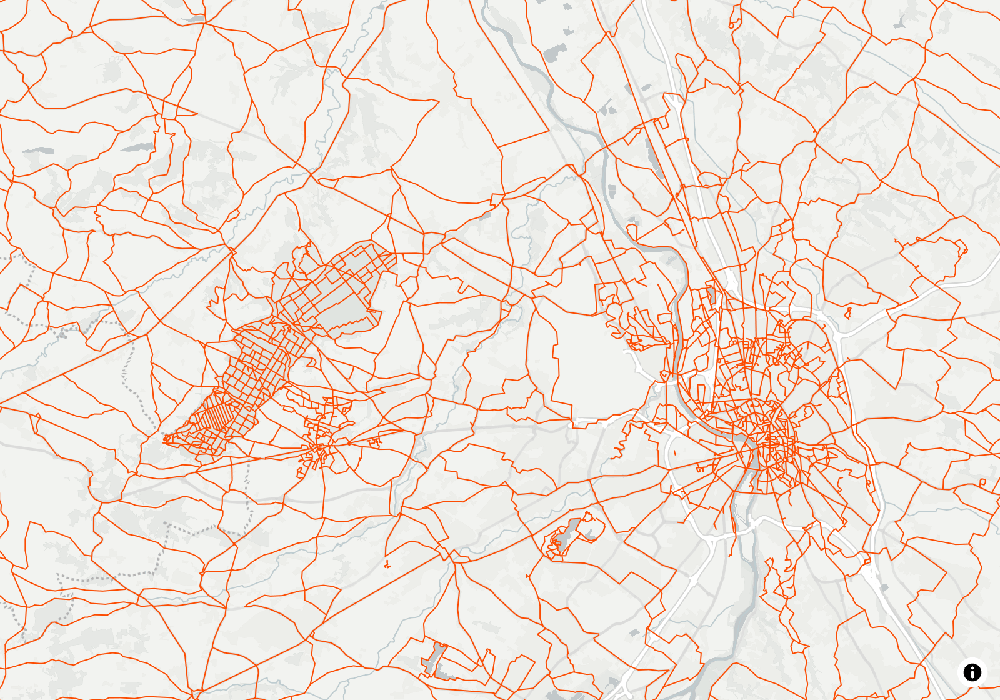
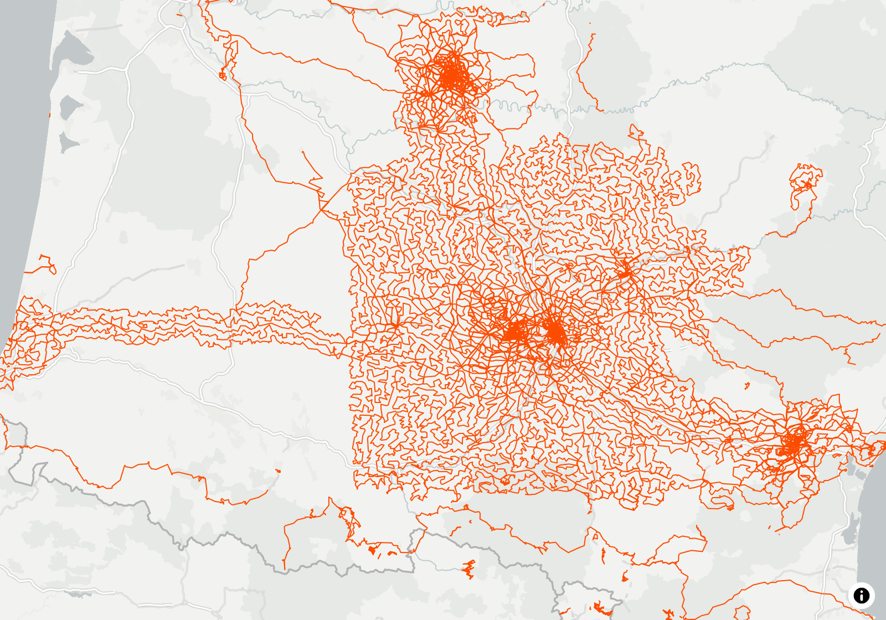

<div align="center">
  <h1>gatsby-strava-declutter</h1>
  <br/>

[![Npm version][badge-npm]][npm]
[![Npm downloads][badge-npm-dl]][npm]
[![MIT license][badge-licence]](./LICENCE.md)
[![PRs welcome][badge-prs-welcome]](#contributing)

</div>

---

Gatsby plugin that draws each road of your Strava activities only once on a map

Drawing every track of a long Strava history gives a map of blobs. This
plugin cuts the parts of a track following a road already drawn, so that
zoomed in every street you went through is drawn once, and zoomed out the
lines stay as fine and as far apart everywhere, however many times you went
through a place.

| With declutter                                 | Without declutter                                    |
| ---------------------------------------------- | ---------------------------------------------------- |
|  |  |
|   |   |

## Usage

1. Download [gatsby-source-strava][gatsby-source-strava] and `gatsby-strava-declutter` from the NPM registry:

```shell
npm install gatsby-source-strava gatsby-strava-declutter
```

2.  Add both plugins in your `gatsby-config.js` file

```js
require("dotenv").config()

module.exports = {
  plugins: [
    "gatsby-source-strava", // MANDATORY
    //
    // It MUST be after `gatsby-source-strava`
    "gatsby-strava-declutter",
  ],
}
```

> [gatsby-source-strava][gatsby-source-strava] needs `clientId`, `clientSecret` and `token` options to works.
>
> Checkout [documentation][gatsby-source-strava].

## Options

| Option     | Default               | What it is                                                                      |
| ---------- | --------------------- | ------------------------------------------------------------------------------- |
| `filter`   | every activity kept   | `(activity) => boolean`, the `StravaActivity` nodes to compare                  |
| `minZoom`  | `6`                   | The lowest zoom generalized, the lower ones draw its lines                      |
| `maxZoom`  | `12`                  | The highest zoom generalized, the full tracks show from the next one            |
| `storeDir` | `".strava-declutter"` | Where the result is kept between builds, see [Store](./docs/declutter.md#store) |

## Data

The plugin adds a `declutter` field to the `StravaActivity` nodes: whether the
activity is drawn, the pieces of its track drawn at every zoom, and the pieces
that depend on the zoom.

> Read the [declutter](./docs/declutter.md) documentation for the options, the
> full field reference, and how to draw it with Mapbox or MapLibre.

## Functions

The logic of the plugin lives in [strava-declutter][strava-declutter], which
works without Gatsby too. The declutter and the track simplification can be
called from your own `gatsby-node.js`:

```js
const {declutter, simplify} = require("gatsby-strava-declutter")
```

To read the declutter of an activity in your own `gatsby-node.js`, get its
`Declutter` node:

```js
const {getDeclutterNodeId} = require("gatsby-strava-declutter")

const declutterNode = getNode(getDeclutterNodeId(activityNode.id))
```

## Contributing

- ⇄ Pull/Merge requests and ★ Stars are always welcome.
- For bugs and feature requests, please [create an issue][github-issue].

## License

This project is licensed under the MIT License - see the [LICENCE](./LICENCE.md) file for details

[badge-npm]: https://img.shields.io/npm/v/gatsby-strava-declutter.svg?style=flat-square
[badge-npm-dl]: https://img.shields.io/npm/dt/gatsby-strava-declutter.svg?style=flat-square
[badge-licence]: https://img.shields.io/badge/license-MIT-blue.svg?style=flat-square
[badge-prs-welcome]: https://img.shields.io/badge/PRs-welcome-brightgreen.svg?style=flat-square
[npm]: https://www.npmjs.org/package/gatsby-strava-declutter
[github-issue]: https://github.com/cedricdelpoux/strava-sync/issues/new
[strava-declutter]: https://github.com/cedricdelpoux/strava-sync/tree/master/packages/strava-declutter
[gatsby-source-strava]: https://github.com/cedricdelpoux/strava-sync/tree/master/packages/gatsby-source-strava
