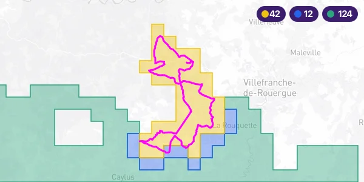

<div align="center">
  <h1>gatsby-strava-tiles</h1>
  <br/>
  <p>
    
  </p>
  <br/>

[![Npm][badge-npm]][npm]
[![Build Status][badge-build]][actions]
[![Coverage][badge-coverage]][codecov]
[![Downloads][badge-downloads]][npm]
[![PRs welcome][badge-prs]][contributing]
[![MIT license][badge-licence]][licence]
[![Sponsor][badge-sponsor]][sponsor]

</div>

---

Gatsby plugin that adds tiles to your Strava data

## Usage

1. Download [gatsby-source-strava][gatsby-source-strava] and `gatsby-strava-tiles` from the NPM registry:

```shell
npm install gatsby-source-strava gatsby-strava-tiles
```

2.  Add [gatsby-source-strava][gatsby-source-strava] and `gatsby-strava-tiles` plugin in your `gatsby-config.js` file

```js
require("dotenv").config()

module.exports = {
  plugins: [
    "gatsby-source-strava", // MANDATORY
    //
    // It MUST be after `gatsby-source-strava` source plugin
    "gatsby-strava-tiles",
  ],
}
```

> [gatsby-source-strava][gatsby-source-strava] needs `clientId`, `clientSecret` and `token` options to works.
>
> Checkout [documentation][gatsby-source-strava].

## Options

```js
module.exports = {
  plugins: [
    {
      resolve: "gatsby-strava-tiles",
      options: {
        routes: {
          strava: true,
          rideWithGps: false,
        },
      },
    },
  ],
}
```

`routes` picks the routes that get a `tiles` field. A key left out keeps its
default, so `routes: {rideWithGps: true}` adds the RideWithGPS routes and keeps
the Strava ones.

| Option               | Default | What it does                                                                                         |
| -------------------- | ------- | ---------------------------------------------------------------------------------------------------- |
| `routes.strava`      | `true`  | Adds tiles to the `StravaRoute` nodes of [gatsby-source-strava][gatsby-source-strava]                |
| `routes.rideWithGps` | `false` | Adds tiles to the `RideWithGpsRoute` nodes of [gatsby-source-ridewithgps][gatsby-source-ridewithgps] |

## Data

The plugin adds a `tiles` field to the `StravaActivity` and `StravaAthlete`
nodes: which tiles each activity covers, and your overall coverage split into
the largest fully covered square, its surrounding cluster, and the rest, plus
the longest unbroken row and column of tiles -- all of it across your whole
history and month by month.

> Read the [data](https://github.com/cedricdelpoux/strava-sync/blob/main/packages/gatsby-strava-tiles/docs/data.md) documentation for the full field reference.

## Helpers

The logic of the plugin lives in [strava-tiles][strava-tiles], which works
without Gatsby too. Its functions are exported, for your own code or for a
plugin built on the tiles: the tiles an activity covers, the conversions
between coordinates and tiles, and the outlines of a set of tiles.

```js
const {
  getActivityTiles,
  pointsToTiles,
  getTileActivities,
  tilesToOutline,
  tileToCoords,
  lngToX,
  latToY,
  xToLng,
  yToLat,
  distanceInMeters,
} = require("gatsby-strava-tiles")
```

> They are also available as `gatsby-strava-tiles/utils/tiles` and
> `gatsby-strava-tiles/utils/map`, which don't load anything else, for code
> running in the browser.

## Activity images

The plugin can also draw an activity as a single image at build time: the ground
already covered around it, the tiles it was the first to cover, the tiles it
closed in, and the track.



```js
const {
  getActivityImages,
  renderActivityImage,
} = require("gatsby-strava-tiles/images")
```

> Read the [images](https://github.com/cedricdelpoux/strava-sync/blob/main/packages/gatsby-strava-tiles/docs/images.md) documentation. Images come from
> [strava-tiles][strava-tiles], and need `sharp`, an optional peer dependency --
> a site using only the tile data never installs it.

## Documentation

- [Data](https://github.com/cedricdelpoux/strava-sync/blob/main/packages/gatsby-strava-tiles/docs/data.md), the GraphQL fields this plugin adds and what they mean
- [Images](https://github.com/cedricdelpoux/strava-sync/blob/main/packages/gatsby-strava-tiles/docs/images.md), drawing an activity as an image at build time

## Support this project

<p align="center">
  <a href="https://github.com/cedricdelpoux"></a>
</p>

<p align="center">
  Hi, I'm <a href="https://cedricdelpoux.fr/en">Cédric</a>.<br>
  Between my three kids, I maintain <a href="https://github.com/cedricdelpoux?tab=repositories">open source projects</a> during my free time.<br>
  If my work is useful to you, a star, a one-time tip or a monthly sponsorship all help a lot.<br>
  Thank you very much!
</p>

<p align="center">
  <a href="https://thanks.dev/u/gh/cedricdelpoux"></a>
  <a href="https://github.com/sponsors/cedricdelpoux"></a>
  <a href="https://ko-fi.com/cedricdelpoux"></a>
  <a href="https://paypal.me/cedricdelpoux"></a>
</p>

[badge-npm]: https://img.shields.io/npm/v/gatsby-strava-tiles.svg?style=flat-square
[badge-downloads]: https://img.shields.io/npm/dt/gatsby-strava-tiles.svg?style=flat-square
[badge-build]: https://img.shields.io/github/actions/workflow/status/cedricdelpoux/strava-sync/ci.yml?branch=main&style=flat-square
[badge-coverage]: https://img.shields.io/codecov/c/github/cedricdelpoux/strava-sync/main.svg?flag=gatsby-strava-tiles&style=flat-square
[badge-prs]: https://img.shields.io/badge/PRs-welcome-brightgreen.svg?style=flat-square
[badge-licence]: https://img.shields.io/badge/license-MIT-blue.svg?style=flat-square
[badge-sponsor]: https://img.shields.io/badge/sponsor-%E2%99%A5-ea4aaa.svg?style=flat-square
[npm]: https://www.npmjs.com/package/gatsby-strava-tiles
[actions]: https://github.com/cedricdelpoux/strava-sync/actions/workflows/ci.yml
[codecov]: https://app.codecov.io/gh/cedricdelpoux/strava-sync/tree/main/packages/gatsby-strava-tiles
[contributing]: https://github.com/cedricdelpoux/strava-sync/blob/main/CONTRIBUTING.md
[licence]: https://github.com/cedricdelpoux/strava-sync/blob/main/LICENCE.md
[sponsor]: #support-this-project
[strava-tiles]: https://github.com/cedricdelpoux/strava-sync/tree/main/packages/strava-tiles
[gatsby-source-strava]: https://github.com/cedricdelpoux/strava-sync/tree/main/packages/gatsby-source-strava
[gatsby-source-ridewithgps]: https://github.com/cedricdelpoux/gatsby-source-ridewithgps
